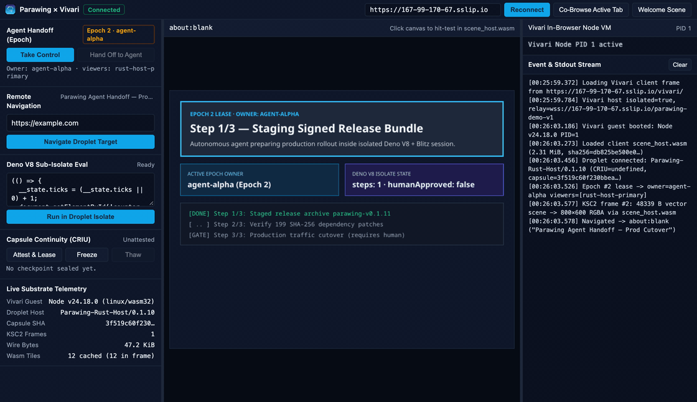
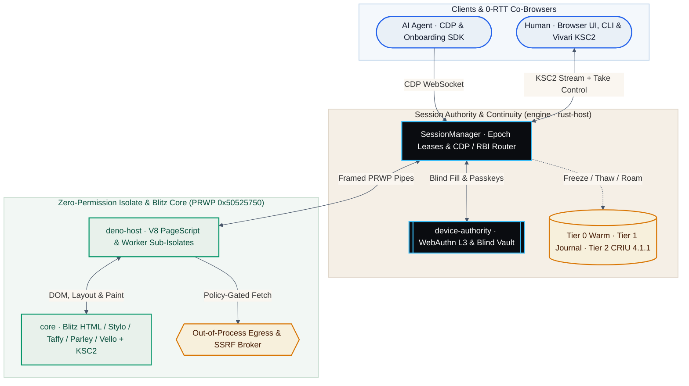

# Parawing

Secure delegated agent co-browser for humans and AI agents to share live web sessions with passkey authority, blind credential brokering, epoch-fenced human handoff, and 0-RTT `KSC2` scene compositing (forked from Kitesurf). **[Live Co-Browser Demo](https://maceip.github.io/parawing/)** · **[Security & OpenVEX Ledger](https://maceip.github.io/parawing/security.html)** · **[Dependency Integrity](deps/README.md)**

## Live Browser Handoff



An autonomous agent casually browses `aol.com` inside a server-side Rust/Blitz + zero-permission Deno V8 isolate until a human clicks **Take Control** to advance the monotonic epoch lease, verify the domain-locked egress gate, and hand back ([`record-browser-handoff.mjs`](demo/e2e/record-browser-handoff.mjs)).

## Architecture



## Quickstart

Requires [Bazelisk](https://github.com/bazelbuild/bazelisk) (`bazel`), Node 22+, `pnpm` 9.15.4, `deno` 2.x, and Rust ([`rust-toolchain.toml`](rust-toolchain.toml)). Licensed under [Apache-2.0](LICENSE) ([NOTICE](NOTICE), [licenses/](licenses/)).

```bash
pnpm install && pnpm run build              # Stage Blitz Wasm, isolate bundles & RBI assets
pnpm run check                              # Bazel type/unit/lint/lockfile + SHA-256 OSV gates
pnpm run browser:onboard https://aol.com/   # Spawn host, browse, disconnect & Tier 0 reconnect
```
